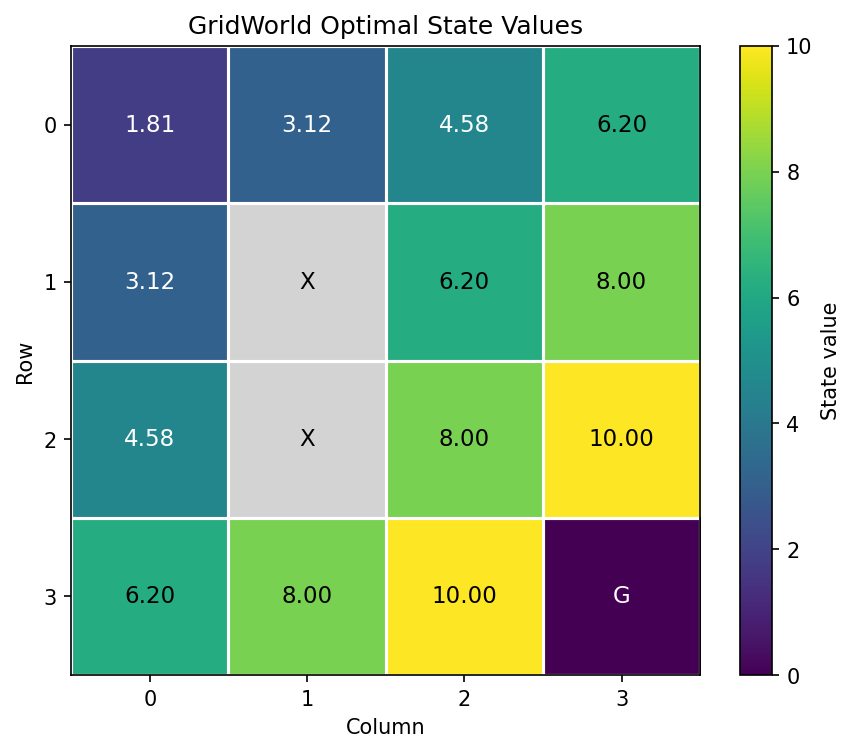

# GridWorld 动态规划项目

## 项目简介

本项目从零实现一个确定性的 4×4 GridWorld 环境，并使用动态规划完成均匀随机策略评估、价值迭代和最优贪心策略提取。项目用于复习 MDP、Bellman 期望方程、Bellman 最优方程、终止状态和策略等强化学习基础概念，同时练习 NumPy、Matplotlib、模块拆分与自动化测试。

智能体的目标是最大化折扣累计回报。由于每个普通步骤奖励为 `-1.0`、到达终点奖励为 `10.0`，在当前确定性环境中，最优策略会倾向于绕开障碍并使用较短路径到达终点。

> 本项目实现了“迭代策略评估”和“价值迭代”，没有实现完整的策略迭代。策略迭代还需要在策略评估后反复执行策略改进，直到策略稳定。

## 环境规则

- 网格大小：4×4
- 起点：`(0, 0)`
- 终点：`(3, 3)`
- 障碍物：`(1, 1)`、`(2, 1)`
- 普通步骤奖励：`-1.0`
- 终点奖励：`10.0`
- 最大步数：`30`
- 撞到边界或障碍物：保持原状态，并获得普通步骤奖励
- 到达终点：回合终止

动作编号：

| 编号 | 方向 | 状态变化 `(row, col)` |
|---:|:---:|:---:|
| 0 | 上 | `(-1, 0)` |
| 1 | 右 | `(0, 1)` |
| 2 | 下 | `(1, 0)` |
| 3 | 左 | `(0, -1)` |

## 实现内容

### GridWorld 环境

`env.py` 定义环境规则及以下接口：

- `reset()`：恢复起点并清零步数；
- `transition(state, action)`：根据指定状态和动作计算转移，不修改环境内部状态，适合动态规划；
- `step(action)`：执行一次真实环境交互，更新内部状态和步数；
- `valid_states()`：返回除障碍物外的合法状态；
- `render()`：以文本形式显示当前网格。

### 均匀随机策略

在每个非终止、非障碍状态下，四个动作的选择概率均为 `0.25`。策略使用形状为 `(rows, cols, action_count)` 的 NumPy 数组保存。

### 迭代策略评估

在策略固定的情况下，使用 Bellman 期望方程反复更新状态价值：

```text
V(s) = Σₐ π(a|s) [r + γV(s')]
```

如果动作到达终点，只保留即时奖励，不再加入下一状态价值。每轮记录所有状态中的最大价值变化，当变化小于阈值 `theta` 时停止迭代。

### 价值迭代

价值迭代不对动作价值求概率加权平均，而是选择 Bellman target 最大的动作：

```text
V*(s) = maxₐ [r + γV*(s')]
```

这一步计算每个状态能够获得的最优折扣累计回报。

### 最优贪心策略提取

根据收敛后的最优状态价值，重新计算每个动作的 Bellman target，选择最大值对应的动作，并将该动作概率设为 `1.0`，其他动作概率保持为 `0.0`。

### 可视化

- 使用 `↑`、`→`、`↓`、`←` 展示每个状态的贪心动作；
- 使用 Matplotlib 绘制最优状态价值热力图；
- 障碍物显示为 `X`，终点显示为 `G`；
- 图片保存到 `outputs/value_heatmap.png`。

### 自动化测试

测试覆盖环境转移、边界、障碍物、终止与截断、策略概率、Bellman 方程、价值迭代收敛、贪心动作、实际路径、文本策略、热力图和完整运行入口。当前共有 25 项测试。

## 项目结构

```text
Gridworld/
├── env.py                       # 环境定义
├── dp.py                        # 策略评估、价值迭代和策略提取
├── visualize.py                 # 箭头策略和价值热力图
├── main.py                      # 完整运行入口
├── requirements.txt             # Python 依赖
├── tests/
│   ├── test_env.py              # 环境测试
│   ├── test_dp.py               # 动态规划测试
│   ├── test_visualize.py        # 可视化测试
│   └── test_main.py             # 集成测试
├── outputs/
│   └── value_heatmap.png        # 程序生成的热力图
└── README.md
```

## 安装依赖

建议在虚拟环境中安装项目依赖：

```powershell
python -m pip install -r requirements.txt
```

## 运行项目

进入项目目录后执行：

```powershell
python main.py
```

程序会输出随机策略价值、最优状态价值和最优箭头策略，同时保存价值热力图。如果 Matplotlib 使用图形界面后端，还会弹出图片窗口；关闭窗口后程序结束。

## 运行结果

随机策略状态价值约为：

```text
[[-8.96 -8.53 -7.44 -6.90]
 [-8.93  0.00 -5.76 -4.98]
 [-8.42  0.00 -2.97 -0.05]
 [-7.21 -4.76  0.01  0.00]]
```

最优状态价值为：

```text
[[ 1.81  3.12  4.58  6.20]
 [ 3.12  0.00  6.20  8.00]
 [ 4.58  0.00  8.00 10.00]
 [ 6.20  8.00 10.00  0.00]]
```

最优贪心策略为：

```text
→ → → ↓
↓ X → ↓
↓ X → ↓
→ → → G
```

从起点按照该确定性策略运行，路径为：

```text
(0,0) → (0,1) → (0,2) → (0,3) → (1,3) → (2,3) → (3,3)
```

该路径经过 6 次动作，前 5 次获得 `-1`，进入终点获得 `10`，未折扣的回合总奖励为 `5`。

## 运行测试

```powershell
python -m pytest -q
```

当前预期结果：

```text
25 passed
```

## 核心知识总结

### 策略评估在计算什么

策略评估计算固定策略下每个状态的期望折扣累计回报。因为均匀随机策略会以相同概率选择四个动作，所以要对四个动作的 Bellman target 按动作概率加权求和。

### 价值迭代与策略评估的区别

策略评估回答“遵循当前策略时，这个状态有多好”；价值迭代回答“每一步都选择当前最优动作时，这个状态最多有多好”。代码上的核心区别是：策略评估进行概率加权求和，价值迭代取所有动作 Bellman target 的最大值。

### 为什么终止状态不能继续自举

自举是用下一状态的估计价值更新当前价值。到达终点后回合已经结束，不再有未来奖励，因此目标值中不能继续加入 `γV(next_state)`。否则会把终点之后不存在的回报重复计入。

### `transition()` 与 `step()` 的区别

`transition(state, action)` 只查询指定状态和动作的结果，不改变环境，适合动态规划遍历所有状态和动作。`step(action)` 根据环境当前状态执行动作，并更新 `state` 和 `steps`，适合智能体实际运行轨迹。

### 为什么最优价值不低于随机策略价值

随机策略对所有动作的价值进行概率加权平均，而价值迭代选择其中的最大值。一个数值集合的最大值不会小于其加权平均值，因此最优价值不会低于该随机策略的价值。

## 输出文件



热力图由 `main.py` 生成并保存到：

```text
outputs/value_heatmap.png
```

## 当前限制与后续方向

- 环境转移是确定性的，没有随机滑动；
- 动态规划依赖已知的环境转移模型；
- 当前只使用一个终点和固定障碍物；
- 尚未实现完整策略迭代；
- 后续将进入无需遍历完整环境模型的 SARSA、Q-learning 和深度强化学习方法。
